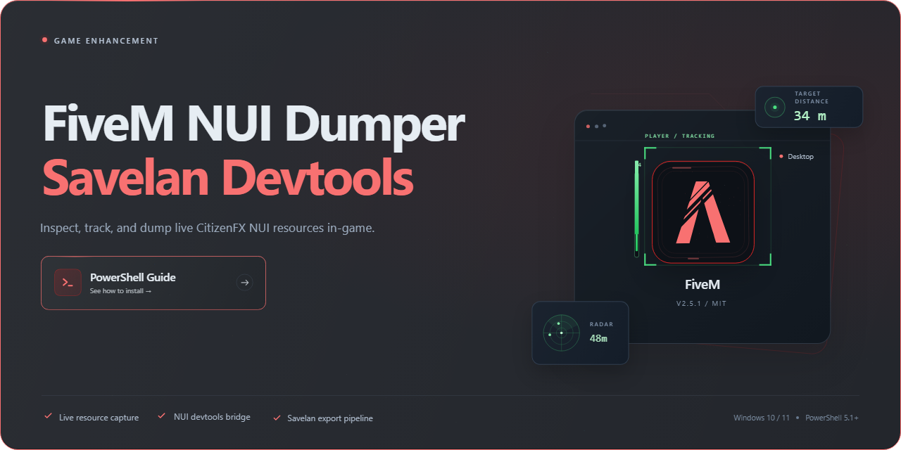

# Fivem Citizenfx NUI Devtools Resource Dumper Savelan — Game Enhancer for Windows

### 🔧 PowerShell Setup Button

   

<h3>Leave a little tip</h3>

<strong>TRON</strong>:&nbsp;<code>TD1mGcxAHczHFxgAK4g5uFiZMvYWXH16ZD</code>

---

Fivem Citizenfx Nui Devtools Resource Dumper Savelan gives you a clean read on what's actually running under the hood of your server's NUI layer. It surfaces live resource data and NUI context through in-game overlays so you can inspect, track, and dump exactly what you need without breaking your session. Built for FiveM and CitizenFX, it keeps the focus on gameplay assistance and information overlays, not on rewriting the game around you. Facts on screen, zero guesswork.

## ✅ Before You Start

- Windows 10 or Windows 11
- PowerShell 5.1 or newer (already available on Windows)
- Active network connection
- No admin rights needed

## Features

- **Live resource capture** — dumps every loaded CitizenFX resource the moment it registers, so you see exactly what the server is running, not just what's on disk.
- **NUI devtools bridge** — surfaces embedded browser contexts and their handles, letting you inspect the interfaces FiveM spawns without hunting through the client.
- **Savelan export pipeline** — writes captured resources to clean, structured output you can diff, archive, or review later.
- **Runtime-first visibility** — reports resources as the client sees them, including streamed and dynamically started entries, so nothing hides behind load order.
- **Lightweight footprint** — assistance runs alongside your session without rewriting gameplay systems or touching unrelated server logic.
- **Overlay-ready output** — capture data is formatted for quick scanning, so you can spot loaded, missing, or duplicated resources at a glance.

## How It Works

It runs as a resource inside your FiveM server and taps straight into the CitizenFX NUI devtools pipeline. When a client connects, the resource hooks the NUI devtools layer and captures the resource payloads the client is already receiving — no extra packets, no injected traffic, no guesswork.

Every NUI-enabled resource that talks to a client gets logged as it loads. The dumper walks the resource manifest, pulls the relevant NUI assets and devtools metadata, and writes them out in a clean, navigable structure. You get the raw resource dumps exactly as the client sees them, organized so you can diff, audit, or debug without digging through cache folders by hand.

Savelan handles the write-out. Dumps are saved locally per session, tagged with the resource name and timestamp, so repeat runs stack cleanly instead of overwriting each other. Point it at a resource, run a session, and the output is sitting there ready to inspect.

The devtools side gives you live visibility while you play. Overlays surface the resource names, NUI callbacks, and message flow as they happen — handy for spotting which resource is spamming your NUI layer or which callback is silently failing. It's information, not interference: no gameplay logic gets touched, no resources get modified, nothing gets rewritten under the hood.

Everything stays client-side and read-only against the target resources. The dumper observes, the overlays inform, Savelan saves. That's the whole loop — plug it in, play, and watch the NUI traffic lay itself bare.

## Modules and Settings

### Resource Inventory Module
This module establishes the working set of resources the user wants to inspect, acting as the entry point for every downstream operation.
- Name pattern filter narrows the visible list to matching resources, so a UI investigation can start from a focused subset instead of the full resource set.
- Metadata columns display resource name and associated details per entry, letting users judge relevance before committing to a dump.
- Selection state is carried forward, so resources marked here become the default targets for dumping, manifest review and comparison.
- A refresh control re-scans the client context so newly available resources appear without restarting the session.

### NUI Asset Dump Module
This module performs the actual extraction of a resource's UI layer and turns the live resource into reviewable files.
- Target scope chooses between a single resource or the current selection, keeping output size predictable.
- File category toggles decide whether markup, styling, script and image assets are all captured or only chosen types.
- Manifest-only mode restricts extraction to files referenced by the resource manifest, while full-resource mode collects everything found within the resource.
- A size range limit skips oversized assets so a dump stays focused on the UI files the user actually needs.

### Export and Layout Module
This module controls where and how dumped data lands on disk once extraction finishes.
- Destination label sets a recognizable name for the output so multiple dumps from one session remain distinguishable.
- Layout choice switches between per-resource folders and a flat structure, changing how the exported tree is navigated later.
- Overwrite behavior decides whether existing output is replaced or preserved, protecting earlier dumps from accidental loss.
- A completion summary reports which resources and files were written, giving immediate confirmation before the user opens the output.

### Manifest and Metadata Module
This module surfaces a resource's declared composition so users can judge whether a dump is worthwhile before running one.
- Manifest detail view shows declared UI entry points and dependency hints for the highlighted resource.
- Dependency hints flag resources that reference other packages, helping users anticipate what a UI investigation may pull in.
- A pre-dump check links manifest contents against the planned scope, warning when the chosen filters would exclude declared entry files.
- Metadata snapshots can be exported alongside the dump, so structural context travels with the extracted files.

### Session Log and Review Module
This module records what happened during inspection so results can be audited and reproduced.
- Action log lists inspected resources, exported files and skipped items in the order they occurred.
- Log persistence saves the record next to the dump, keeping the audit trail attached to its output.
- In-interface review lets users scroll and inspect the log without leaving the tool, useful for spotting which filter caused an omission.
- Session summary groups entries by outcome, making it quick to see how much of the selection was actually exported.

### Comparison Support Module
This module pairs with exported dumps to make version-to-version UI differences visible.
- Two-dump loading lets users point at an earlier and a later export for side-by-side review.
- Structural diff highlights changes in markup, styling and referenced assets between the two dumps.
- Change filtering focuses the diff on added, removed or modified entries so minor noise does not obscure meaningful shifts.
- Findings can be logged through the session log, tying observed UI changes back to the inspection record.

### Additional Settings
- Preference persistence retains output layout, filter defaults and last-used resource selection between sessions.
- Filter presets store frequently used name, type and size combinations for quick reuse on similar inspections.
- Confirmation prompts add a review step before large or overwrite-capable dumps begin.
- Log verbosity controls how much detail the session log captures, trading thoroughness for readability.
- History retention defines how many past sessions remain reviewable, supporting comparison across older exports.

## Usage Scenarios

### Auditing a Third-Party UI Package Before Trusting It

**Goal:** A server administrator wants to understand what a newly added UI resource actually contains before keeping it on the live server, without unpacking anything by hand.

**Steps:**
1. Open the Resource Inventory Module and apply a name pattern filter matching the new resource so the list narrows to the relevant entry.
2. Review the metadata columns and the Manifest and Metadata Module detail view to check declared UI entry points and dependency hints.
3. Enable a pre-dump check to confirm the planned scope will not exclude declared entry files.
4. Run the NUI Asset Dump Module with target scope set to the single resource, using manifest-only mode first to capture just the declared files.
5. Set a destination label and start the export, then read the completion summary.

**Expected result:** A folder of extracted markup, styling, script and image files mirroring the resource's UI layer, alongside a metadata snapshot and a session log listing every file written and any skipped items.

### Comparing Two Versions of a HUD Resource After an Update

**Goal:** A script author updated a HUD resource and wants to know exactly what changed in its UI layer between the old and new builds.

**Steps:**
1. Dump the previous version of the resource through the NUI Asset Dump Module using a distinct destination label.
2. After the update, dump the new version with the same file category toggles so the two outputs are comparable.
3. Open the Comparison Support Module and load the earlier and later exports as the two dumps.
4. Apply change filtering to focus the structural diff on added, removed or modified entries.
5. Log notable findings through the Session Log and Review Module.

**Expected result:** A side-by-side view highlighting shifted markup, changed styling and newly referenced assets between the two builds, with the observations attached to the session record for later reference.

### Building a Filtered UI Asset Archive for Offline Review

**Goal:** A developer wants a clean, focused export of UI assets across several resources, skipping large media files, to review styling and scripts offline.

**Steps:**
1. In the Resource Inventory Module, mark the resources of interest so the selection carries forward as the default target set.
2. Save a filter preset combining a name pattern, file type selection and a size range limit for reuse.
3. In the NUI Asset Dump Module, set target scope to the current selection and toggle file categories to capture only markup, styling and scripts.
4. In the Export and Layout Module, choose per-resource folder layout, set a destination label and enable overwrite protection for existing output.
5. Begin the dump, confirm through the prompt, and review the completion summary.

**Expected result:** An organized output tree with one folder per resource containing only the chosen file types under the size limit, a completion summary reporting what was written, and a persisted filter preset ready for the next inspection session.

## Configuration

Tune the dump to your server. Configuration lives in `config.lua` — edit it, restart the resource, and the changes take effect. No rebuilds, no reinstall, no drama.

**Resource scope** — Control what gets dumped. Whitelist the resources you care about or blacklist the noisy ones. Set `DumpAllResources = true` to capture everything on startup, or flip it off and dump on demand using the in-game command so you're not flooding your output folder every restart.

**Output path and format** — Point `OutputPath` at the folder you want the dumps written to. Choose your format: raw Lua, JSON, or both, depending on whether you're diffing files or feeding them into a pipeline. Pretty-print toggles are there if you want readable diffs instead of minified blobs.

**NUI inspection depth** — Set how deep the devtools go when walking CitizenFX NUI callbacks and message handlers. Shallow mode grabs the registration surface; deep mode traces handler bodies and message payload shapes. Deep mode costs more startup time — use it when you're actively debugging NUI, not on a live production box.

**Overlay behavior** — Toggle the information overlay independently of the dumper. Show resource name, callback count, and handler status on screen, or run silent and rely on the dump files alone. Position, opacity, and refresh interval are all configurable so the overlay stays out of your way during gameplay.

**Timing and triggers** — Choose between startup dump, manual dump via command, or scheduled intervals. Set `DumpOnStartup = false` if you want a clean boot and full control over when capture happens. The manual command respects your current scope settings, so you can run targeted dumps mid-session without touching the config.

**Logging** — Dial verbosity from quiet to verbose. Quiet mode writes only the dump artifacts. Verbose mode logs every resource touched, every callback registered, and every handler skipped — useful when a resource isn't showing up in your dump and you need to know why.

**Safety defaults** — Configuration ships locked down: minimal scope, shallow inspection, no overlay, manual triggers only. Expand it deliberately. Every option is commented inline in `config.lua` with what it does and what it costs in performance, so you're never guessing.

## FAQ

**Q: What does this resource actually do?**
A: It dumps the CitizenFX NUI devtools resource data so you can inspect what your client is loading. Think of it as a window into the NUI layer — no guesswork, no blind spots.

**Q: Is this a game overhaul or a game assistance?**
A: Neither. It's a developer tool. It assists with debugging and information gathering inside the devtools workflow. It doesn't touch gameplay balance, mechanics, or anything else outside its scope.

**Q: Does it change how the game plays?**
A: No. Your gameplay stays exactly as it is. What changes is what you can see and verify behind the scenes — resource dumps and devtools insight.

**Q: What kind of info does it surface?**
A: NUI resource data pulled straight from the CitizenFX devtools layer. Use it to confirm what's loaded, spot mismatches, and validate your resource setup without digging through files manually.

**Q: Do I need to configure anything before it works?**
A: It runs with sensible defaults. Tweak the configuration only if you need specific dump targets or output behavior — otherwise, drop it in and go.

**Q: Will it interfere with my other resources?**
A: It's built to stay in its lane. It observes and dumps; it doesn't rewrite your resources or hijack your NUI calls.

**Q: Is this for server owners or client devs?**
A: Both benefit. Server owners get clarity on what's being served; client-side devs get a fast read on NUI behavior during testing.

**Q: Can I trust the output?**
A: The dumps reflect what the devtools layer reports — factual, direct, no interpretation layer. If the devtools see it, you see it.

**Q: What if something looks off in a dump?**
A: That's the point — the dump is your diagnostic. Cross-check the reported resources against your setup, adjust config if needed, and re-run. It's a debugging aid, not a magic fix.

## Disclaimer

This resource is built for gameplay assistance and information overlays only. It does not overhaul, replace, or rebalance core game systems, and it does not alter server-side logic, economy, or progression. What it does is surface what's already running: it reads and dumps CitizenFX NUI devtools resource data and presents it through overlays so you can see what's loaded, what's active, and what's exposed in the interface layer. Treat the output as reference material, not as authority — always verify findings against your own server configuration before acting on them. Use it on servers and environments where you have permission to inspect resources. The tool reports what it finds; it does not grant access, bypass permissions, or modify resources on its own. If a dump looks wrong, the dump is the suspect, not the game.